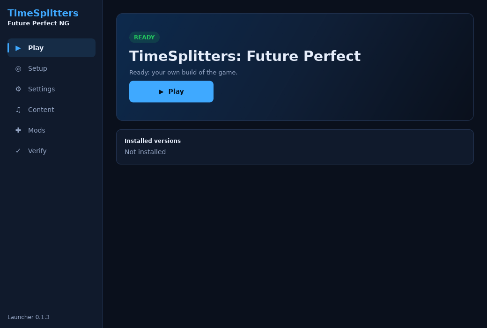
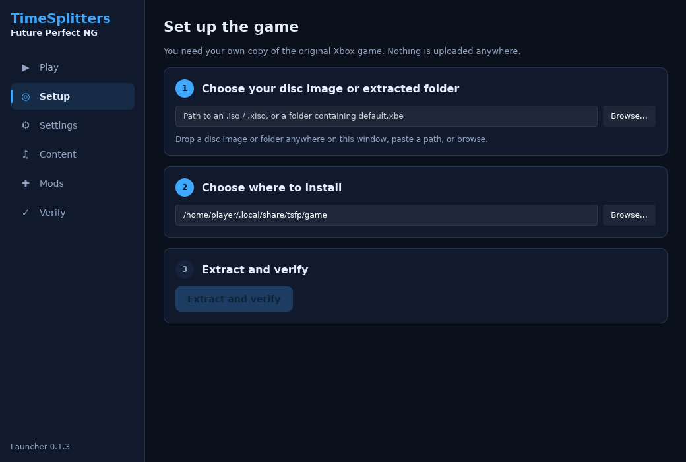
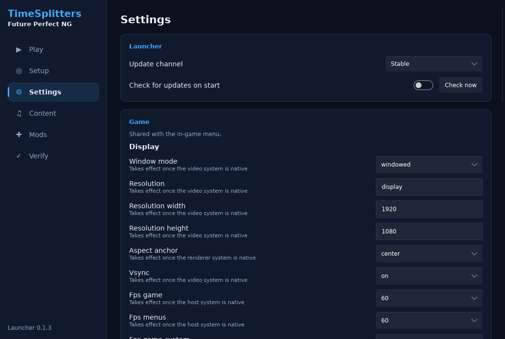
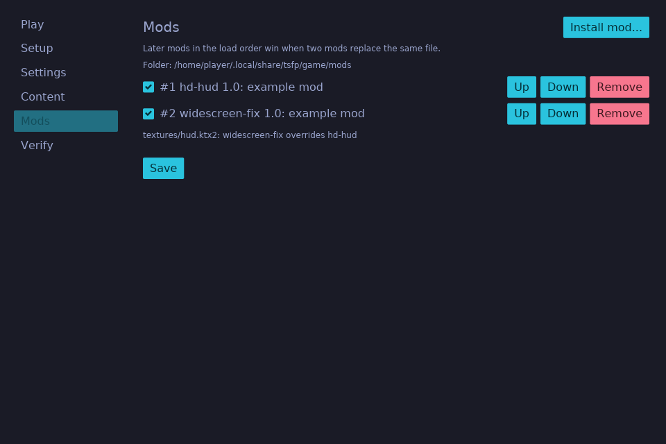

# TimeSplitters: Future Perfect NG

**TimeSplitters: Future Perfect - Next Generation** 
A native, open-source rebuild of *TimeSplitters: Future Perfect* for modern PCs, 
with a launcher that sets everything up from your own copy of the game.

 
🟢 available · 🔵 in progress · ⚪ planned · <a href="docs/GOALS.md">full roadmap</a> 

<a href="https://github.com/NeilSeligmann/timesplitters-future-perfect-ng/releases/latest">More downloads on the releases page</a>: Windows and Linux on ARM, release notes, checksums and signatures · <a href="docs/players/verifying-downloads.md">How to verify a download</a>

**[Get started](#get-started)** · [Launcher guide](docs/players/launcher.md) · [Modding](docs/modding.md) · [Roadmap](docs/GOALS.md) · [Build from source](docs/development/building.md)

> [!IMPORTANT]
> **Bring your own disc.** You need your own copy of the original Xbox game, as a disc image (ISO) or an extracted
> folder. No game files are included or downloadable here, and the launcher never uploads them anywhere.

> [!WARNING]
> **Early development.** The launcher (setup, verification, settings, mods, updates) works today. The game itself is
> still being rebuilt: until it ships for your platform, **Play** tells you it is not available yet. Follow progress in
> the [roadmap](docs/GOALS.md).

<table>
  <tr>
    <td width="50%"></td>
    <td width="50%"></td>
  </tr>
  <tr>
    <td width="50%"></td>
    <td width="50%"></td>
  </tr>
</table>

## Get started

| Step | |
| :---: | --- |
| **1** | **Download the launcher** for your system with the buttons above. Windows: a single `.exe`, no installer. macOS: open the `.dmg` and drag the app to Applications. Linux: make the `.AppImage` executable (`chmod +x`) and run it. |
| **2** | **First launch.** The launcher is not code-signed yet. Windows SmartScreen: *More info → Run anyway*. macOS: right-click the app → *Open* the first time. |
| **3** | **Set up your game.** The launcher opens on *Setup*. Choose your disc image or extracted folder; it is identified by the hash of its `default.xbe`. Pick a game folder and press *Extract and verify*. |
| **4** | **Optional extras.** Higher-quality music and texture packs (*Content*), mods (*Mods*), and settings (*Settings*). |
| **5** | **Play.** Press *Play* on the first tab once the game is available for your platform. |

The launcher keeps itself up to date: it checks for new releases on start (turn this off in *Settings*) and only installs
updates whose signature matches the project's release key.

## What the launcher does

- **Guided setup** from your disc image or extracted folder, with known-good dump detection.
- **Lossless asset import**: game data is extracted once into open formats where that is exact, and kept as original
  bytes where it is not.
- **Verify and repair**: every installed file is checked against its SHA-256; damaged installs are flagged.
- **Settings** for the launcher and the game, in the same file the in-game menu uses.
- **Mods** from zip files, with load order and conflict view. Mods that change gameplay are labelled.
- **Content packs** for higher-quality music and textures (signed manifests, per-file hashes). Packs are coming soon.
- **Signed self-updates** on a Stable or Nightly channel.

See the full [roadmap](docs/GOALS.md) for the game itself: widescreen and ultrawide, high frame rate, native keyboard
and mouse, online co-op, Map Maker improvements and more, with what already works today.

## Guides

| Guide | |
| --- | --- |
| [Launcher guide](docs/players/launcher.md) | Every tab, where files are stored, updates and channels |
| [Verifying downloads](docs/players/verifying-downloads.md) | Check checksums and signatures of release files |
| [Modding](docs/modding.md) | Make a mod: `mod.json`, file layout, load order |
| [Troubleshooting](docs/TROUBLESHOOTING.md) | Common setup problems |
| [Building from source](docs/development/building.md) | Build the launcher and the recompiled game yourself |

## Disclaimer

This is an unofficial fan project, made for preservation and to run a game you own on modern hardware. It is **not
affiliated with or endorsed by** the developers, publishers or current rights holders of *TimeSplitters*, including
Free Radical Design and Electronic Arts. *TimeSplitters* and related names are trademarks of their respective owners.

- No original game code, assets, or disc data are distributed in this repository or its releases. Release trees are
  scanned for disc-derived data before publication.
- You must own the game and supply your own copy. Do not share disc images or extracted game files, including in
  issues.
- The software is provided as-is, without warranty (see the license).

Parts of this project's code and documentation were written with AI assistance and reviewed by its maintainers; see
[AI-DISCLOSURE.md](AI-DISCLOSURE.md).

## License

[GPL-3.0-or-later](LICENSE). Third-party components keep their own licenses; see
[LICENSE-NOTICES.md](LICENSE-NOTICES.md).
