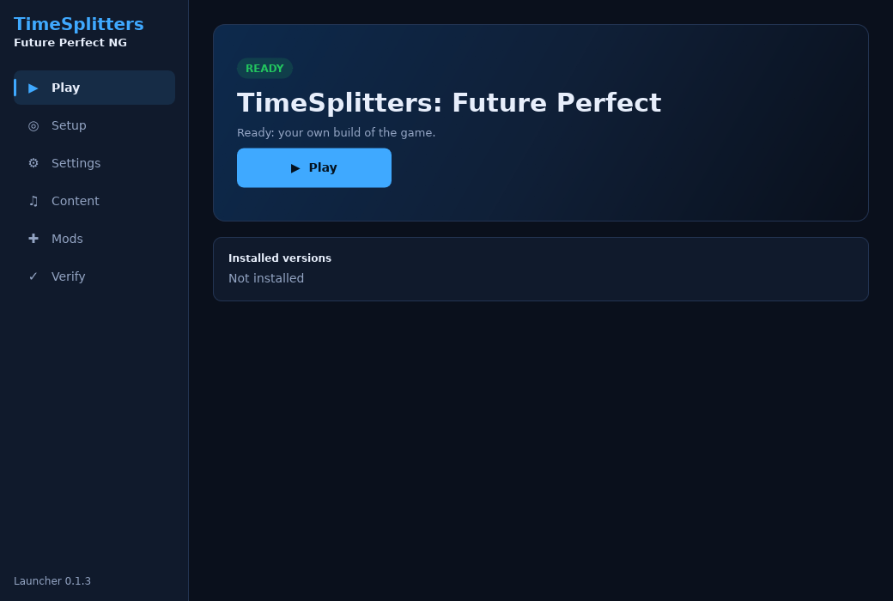
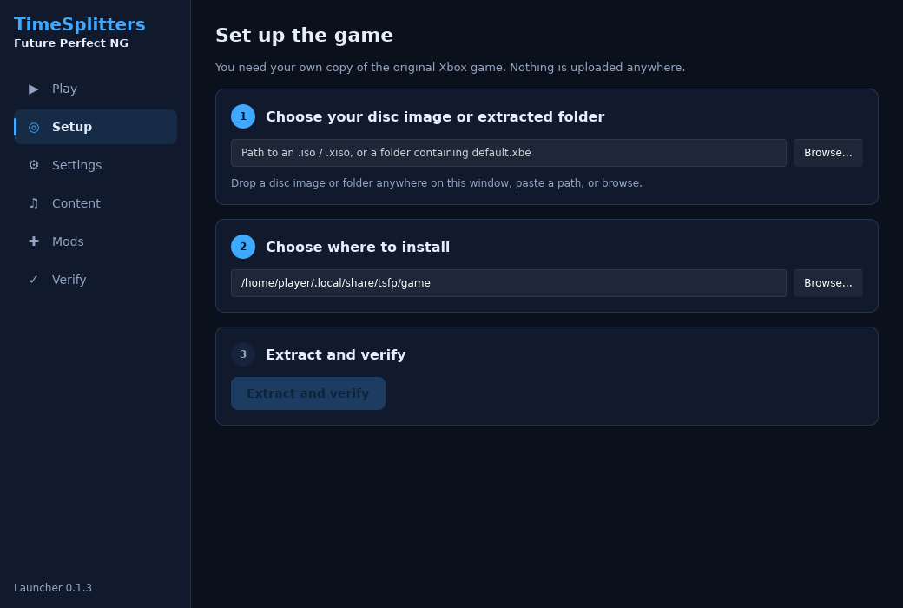
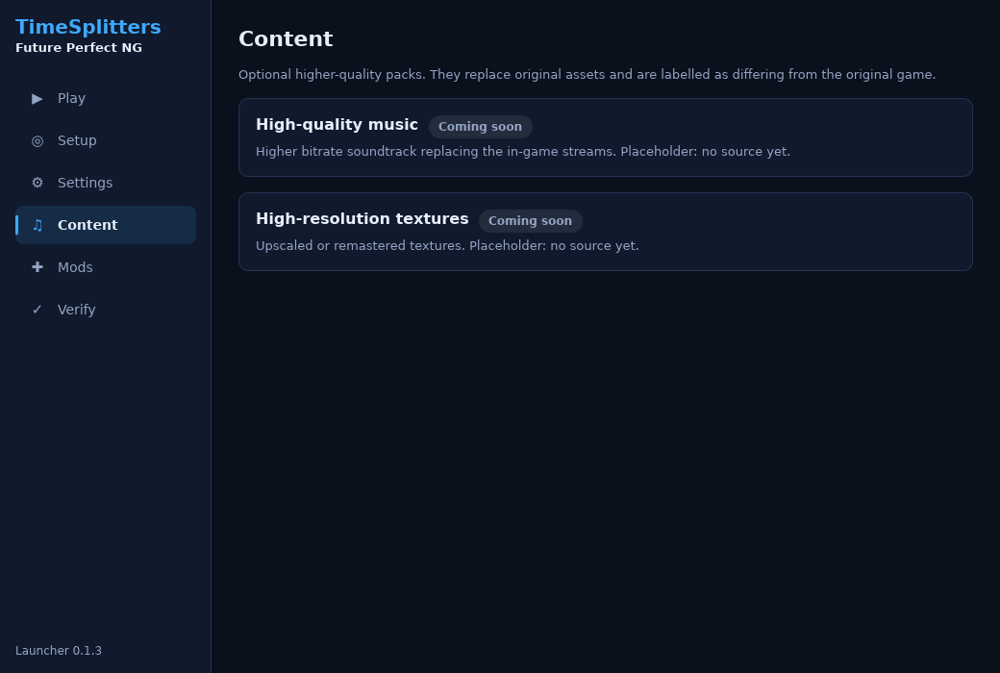
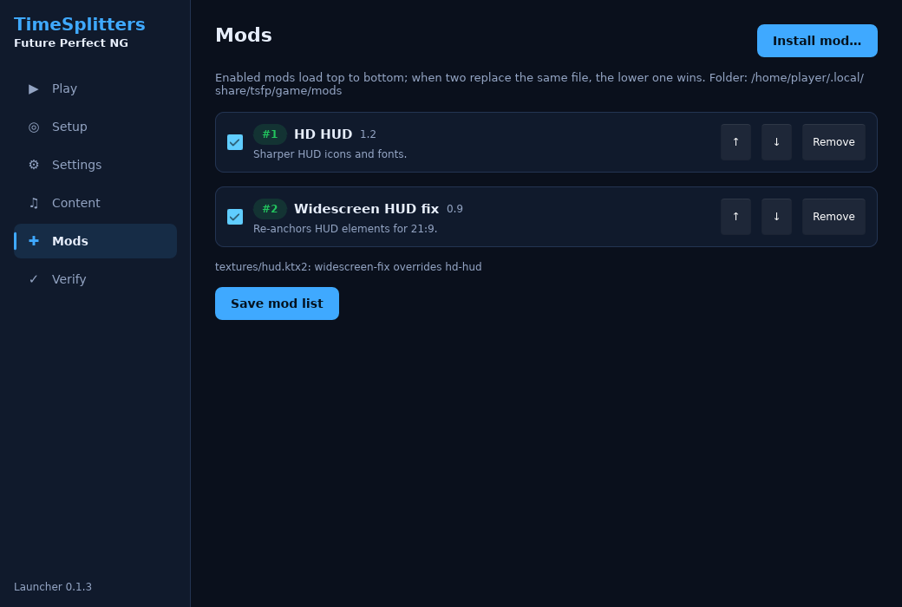

# Launcher guide

The launcher has six tabs. It opens on **Setup** until a game is installed, then on **Play**.

| Tab | What it does |
| --- | --- |
| **Play** | Starts the game. In a source checkout it builds the game for you first when needed (*Build the game*, with progress and Cancel) and then runs it; build and game logs go to the launcher's `logs` folder. |
| **Setup** | Drop your disc image or folder on the window, paste its path, or browse; it is identified right away. Pick a game folder, then *Extract and verify*: every step shows its own progress. Run it again to check and repair; a complete install is verified and kept instead of extracted again. |
| **Settings** | Update channel and automatic update check, plus every game setting. Settings that are not wired into the game yet say which system they wait for. |
| **Content** | Optional high-quality music and texture packs: install, repair, remove. |
| **Mods** | Install mods from a zip (or drop one on the window), enable them, set load order, see conflicts, remove. See [Modding](../modding.md). |
| **Verify** | Re-check every installed file against its recorded SHA-256. |

| | |
| --- | --- |
|  |  |
|  |  |

## Your disc

Supported today: the original Xbox release, as an ISO (`.iso`, `.xiso`) or an extracted folder that contains
`default.xbe`. The launcher reads the disc's `default.xbe` hash to recognise it:

- **Recognised:** installs straight away.
- **Unknown dump:** the launcher shows the hash and asks before installing. It may work, but it is untested.
- **No `default.xbe`:** not an Xbox game disc; nothing is installed.

## Where files go

| | Linux | macOS | Windows |
| --- | --- | --- | --- |
| Game folder (default) | `~/.local/share/tsfp/game` | `~/Library/Application Support/tsfp/game` | `%LOCALAPPDATA%\tsfp\game` |
| Launcher and game settings | `~/.config/tsfp/` | `~/Library/Application Support/tsfp/` | `%APPDATA%\tsfp\` |

Inside the game folder: `disc/` keeps a verified copy of your disc image (so later updates can read the original
disc again; extracted folders are kept inside the import instead), `assets/original/<version>/` holds the imported
game data with its manifest,
`assets/overrides/` holds content packs, and `mods/` holds mods.

## Updates

- **Stable** follows full releases. **Nightly** also takes pre-releases.
- The launcher downloads the build for your platform and its `.minisig` signature, and installs it only if the
  signature matches the release key (see [Verifying downloads](verifying-downloads.md)). Restart to finish.
- Intel Macs have no release builds; build from source (see [Building](../development/building.md)).

## Disk space

A full import of the Xbox disc needs about 16 GB for the extracted and converted game data, plus the size of your disc
image for the kept copy (about 4 GB for the Xbox ISO). The launcher shows the image size before you install.
